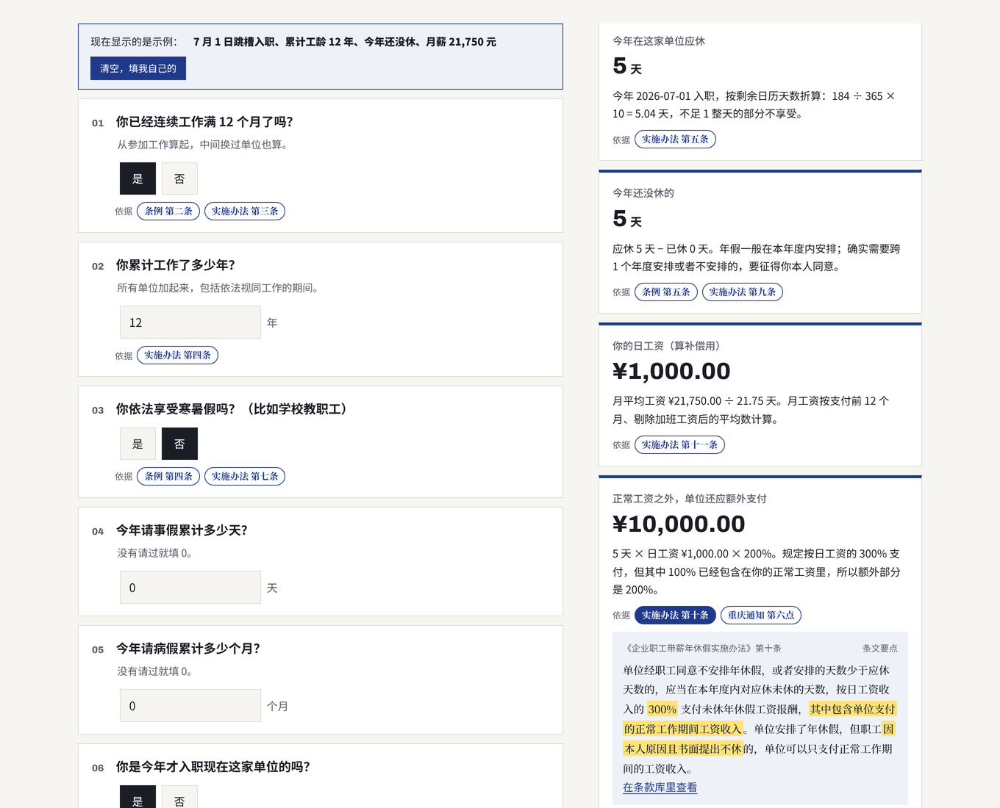

# 条款自测 · clause-check

**把几十页的政策、制度和条款，变成一分钟就能点完的自测页。每个结论都标出依据的条款。** 一个开源 Claude Skill。



> 示例：年假自测器。依据《职工带薪年休假条例》和《企业职工带薪年休假实施办法》，算出今年应休几天、离职时怎么折算、没休完单位应额外支付多少。
> 下载 [`examples/annual-leave.html`](examples/annual-leave.html) 用浏览器打开。

## 解决什么问题

人最常问的问题是"**我**符不符合""**我**能拿多少"：能休几天年假、产假有多长、能领多少补贴、保险赔不赔、报名条件够不够、公司报销标准是多少……

答案都在规则文件里，但：
- 把文件甩给人，人看不懂；
- 直接问 AI，答案没法核对，算错了也不知道。

条款自测把两者合起来：**读者回答自己的情况，页面按条款算出结论，每个结论旁边都有"依据"，点开就是条文。**

## 和直接问 AI 有什么不同

| | 直接问 AI | 条款自测 |
|---|---|---|
| 依据 | 说不清出自哪一条 | 每个结论都挂着条号，点开看条文，关键句高亮 |
| 算法 | 每次可能不一样 | 写成一张判断表，同样的回答永远得到同样的结论 |
| 正确性 | 没人检查 | 配置自带测试用例，生成前必须全部通过；页面打开时还会再自检一遍 |
| 边界 | 不说自己不知道什么 | 单独列出"这个自测没有覆盖" |
| 分享 | 一段聊天记录 | 一个网页，发给同事、粉丝、客户都能自己点 |

## 适合做什么

- **劳动权益**：年假、产假、加班费、经济补偿
- **政策申请**：补贴、人才政策、落户积分、居住证
- **公司制度**：报销标准、福利资格、差旅等级、绩效奖金算法
- **保险与合同**：理赔条件、免责情形、退费规则
- **考试与报名**：报考条件、加分政策、免试资格

## 安装

**Claude 网页版 / App**：把 `clause-check` 文件夹打成 zip，在设置中的 Skills 处上传（需要开启代码执行）。

**Claude Code**：
```bash
mkdir -p ~/.claude/skills && cp -r clause-check ~/.claude/skills/
```

## 用法

```
把我们公司的差旅报销制度做成一个自测页（附上制度文件）
我想知道自己能不能申请上海的人才住房补贴，做个自测
产假到底能休多少天？按广东的规定做个计算器
帮我把这份保险条款做成"这种情况赔不赔"的自测
```

它会：找到或读取规则原文 → 只挑会改变结论的条款 → 设计问题 → 写成判断表 → 写测试用例并跑通 → 生成页面。

## 不用 Claude 也能用

```bash
python3 scripts/clausecheck.py check my.json                  # 校验配置，跑测试用例
python3 scripts/clausecheck.py try my.json '{"years": 3}'      # 用一组答案试算
python3 scripts/clausecheck.py build my.json -o my.html        # 生成页面
```

配置格式和表达式写法见 `SKILL.md`，完整示例见 `examples/annual-leave.json`。

## 目录

```
clause-check/
├── SKILL.md              # 给 Claude 的说明：从规则文件到判断表的方法、诚实规则、配置格式
├── assets/engine.html    # 引擎：问题流、判断表、条款引用、示例模式、自检（单文件，无依赖）
├── scripts/clausecheck.py# 同一套求值规则的 Python 版：校验、跑测试、试算、生成（只用标准库）
└── examples/             # 年假自测的配置、生成的页面和预览图
```

## 免责

生成的自测页是按条款做的初步判断，不构成法律、税务或保险意见。示例中的条款是对公开文件的准确概括，原文以发布机关公布的版本为准。

## English

**clause-check** is an open-source Claude Skill that turns any rules document (policies, HR handbooks, insurance terms, eligibility rules) into an interactive self-check page. Readers answer a few questions about their own situation; the page computes the result with an auditable decision table and shows the exact clause behind every conclusion. Configs ship with test cases that must pass before the page is generated, and the page re-runs them on load.

## 许可

MIT © 2026 朝礼
